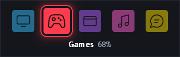
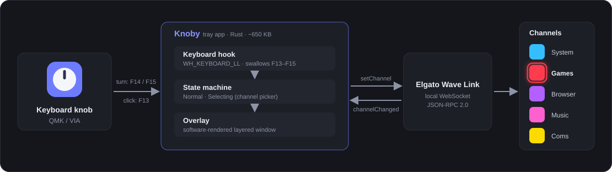

# Knoby

**Control Elgato Wave Link channel volume with your keyboard's volume knob.**

A tiny Windows tray app (Rust, ~650 KB, no installer) that turns a rotary encoder on a QMK / VIA keyboard
into a per-channel volume knob for [Elgato Wave Link](https://www.elgato.com/wave-link): turn for volume,
click to mute, double-click to pick which channel you are controlling.

<p align="center">
  
</p>

<p align="center">
  <a href="https://github.com/fdemusso/knoby/actions/workflows/ci.yml"></a>
  
  
  
</p>

## Why

A keyboard volume knob sends the standard media keys, so it only moves the **Windows master volume**. If you
mix with Wave Link (and maybe a Stream Deck) you want the knob to drive the *channel* you are actually
listening to: music, game, browser or voice chat. Knoby makes that happen.

## Features

- **Per-channel volume** on any Wave Link software channel: turn for volume, click to mute / unmute.
- **Channel picker**: double-click the knob, turn to move between your channel icons, click to confirm.
  An unobtrusive overlay slides in at a screen corner and never steals focus, so it is safe to use
  mid-game.
- **Always in sync**: stays consistent with Wave Link and Stream Deck, with no polling.
- **Your channels, your icons**: names, colours and icons come straight from Wave Link, and new channels
  show up automatically.
- **Tiny and quiet**: ~650 KB, ~13 MB of RAM, about 0.3% of one core when idle.
- **Tray icon** with status, *Start with Windows*, *Open config file*, *Reload config* and *Quit*.
- **Configurable**: volume step, picker speed, double-click timing, overlay corner and margin.

## Quick start

1. Install [Elgato Wave Link 3](https://www.elgato.com/wave-link) and create the channels you want.
2. In [VIA](https://www.caniusevia.com/) (or QMK), map the knob to unused keys:

   | Knob | Key |
   |---|---|
   | counter-clockwise | `F14` |
   | clockwise | `F15` |
   | click | `F13` |

3. Download `knoby.exe` (or the `.zip`) from the [latest release](../../releases/latest) and run it.
   There is no window: look for the knob icon in the notification area.
4. Turn the knob. Double-click to open the channel picker.

> **Tip:** use the tray menu to enable *Start with Windows*. Move `knoby.exe` to a permanent folder first:
> the startup entry points at the file you ran.

The executable is not code-signed, so Windows SmartScreen may warn the first time you run a downloaded copy.

## How it works



- A global **low-level keyboard hook** (`WH_KEYBOARD_LL`) intercepts the three knob keys, so the system
  volume never moves.
- Wave Link is controlled through the **local JSON-RPC WebSocket** it exposes: Knoby reads the channel list
  (names, levels, icons) and writes `level` / `isMuted`. It follows `channelChanged` notifications to stay in
  sync with any other controller.
- The overlay is a **software-rendered layered window** (per-pixel alpha, anti-aliased, animated) with no GPU
  or UI framework, which keeps the binary tiny. The selection ring takes the colour of the selected icon.

Deeper dive, including the verified Wave Link protocol notes and the decisions made along the way, in
[docs/DESIGN.md](docs/DESIGN.md).

## Configuration

Settings live in `%APPDATA%\Knoby\config.toml`, created with commented defaults on first run. Use the tray
menu: **Open config file** to edit it, **Reload config** to apply changes without restarting.

| Setting | Default | Meaning |
|---|---|---|
| `volume_step` | `3` | Volume change per knob detent, in percent (1-20) |
| `select_detents` | `1` | Detents needed to move the picker by one icon (1-6); 1 = every detent moves one icon |
| `select_min_ms` | `90` | Speed limit: detents sooner than this after the last move are ignored (0-500) |
| `double_click_ms` | `250` | Double-click window; a single click (mute) fires after this delay (100-600) |
| `select_timeout_ms` | `4000` | The picker closes after this long without input (1000-15000) |
| `overlay_corner` | `"top-right"` | `top-right`, `top-left`, `bottom-right` or `bottom-left` |
| `overlay_margin` | `24` | Distance from the screen edge, in pixels (0-200) |

Invalid values are ignored (the default is used) and reported on stderr in debug builds.

## Build from source

Requires a recent stable [Rust](https://rustup.rs/) toolchain (MSVC) on Windows.

```
cargo build --release     # target\release\knoby.exe, no console window
cargo run                 # debug build: keeps the console for logging
cargo test
```

Developer switches (environment variables): `KNOBY_DEBUG=1` logs every intercepted key,
`KNOBY_PREVIEW=<file.png>` opens the overlay and saves one frame, `KNOBY_ACCEPT_INJECTED=1` lets scripted
key presses drive Knoby (used for automated testing).

## Compatibility and limitations

- Windows 11 and Elgato Wave Link **3.x** (developed against 3.4.0). Wave Link 2 uses a different protocol.
- The Wave Link WebSocket protocol is not covered by a public stability guarantee, so a future Wave Link
  update could require changes.
- The overlay is a topmost, non-activating window: it is designed to show over windowed and borderless games,
  but exclusive fullscreen is not guaranteed.

## Related topics

Elgato Wave Link, volume knob, rotary encoder, QMK, VIA, custom keyboard, Stream Deck, per-app volume
control, audio mixer, Windows tray utility, Win32, low-level keyboard hook, Rust.

> [!IMPORTANT]
> **Disclaimer:** Knoby is an independent project and is not affiliated with or endorsed by Elgato or
> Corsair. Wave Link and Stream Deck are trademarks of their respective owners.

## License

[MIT](LICENSE) © 2026 Flavio De Musso.
